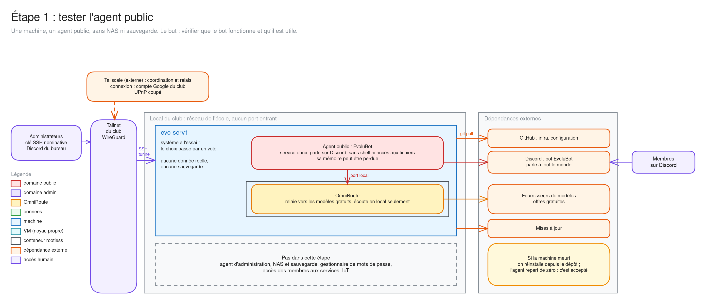

# Étape 1 : tester l'agent public

Ce qu'on met en place maintenant sur [`evo-serv1`](evo-serv1.md), et ce qu'on ne fait pas encore. Le but est de **vérifier que le bot fonctionne et qu'il est utile**, pas d'installer l'infrastructure définitive du club. Tout peut encore changer, à commencer par le [système de la machine](choix-du-systeme.md).

Le schéma se modifie sur [excalidraw.com](https://excalidraw.com), à partir de [son fichier source](schemas/etape-1-agent-public.excalidraw).

## Ce que couvre cette étape

- **Une machine :** `evo-serv1`, avec ce dont l'agent a besoin.
- **Un agent :** le bot public EvoluBot, sur le Discord du club, qui passe par OmniRoute pour joindre les modèles.
- **L'accès des administrateurs**, pour maintenir la machine à distance.

Cette étape se fait en plusieurs PR : la première pose la machine, les suivantes ajoutent les services un par un.

## Ce qu'elle ne couvre pas

| Pas encore | Conséquence pendant cette étape |
|---|---|
| Agent d'administration | aucun accès aux mails, au fichier des membres ni aux droits de modération |
| NAS | aucun fichier du club accessible à l'agent |
| **Sauvegarde** | voir ci-dessous |
| Gestionnaire de mots de passe | aucun mot de passe du club sur cette machine |
| Accès des membres aux services | les membres passent uniquement par Discord |
| Machine IoT, autres services de l'association | rien de tout cela sur cette machine |

L'architecture d'ensemble du club se discute à part, dans sa propre PR.

## Sans NAS, donc sans sauvegarde

Il n'y a **aucune sauvegarde hors de la machine** pendant cette étape. C'est un choix : si un disque ou la machine lâche, on perd la mémoire de l'agent et les réglages d'OmniRoute, et c'est acceptable tant qu'on ne fait que tester.

Ce choix impose une règle : **rien d'irremplaçable ni de sensible sur cette machine.**

| Ce qu'on perdrait | Ce qu'on fait alors |
|---|---|
| Configuration et secrets chiffrés | rien à refaire : ils sont dans ce dépôt |
| Mémoire et sessions de l'agent | l'agent repart de zéro |
| Réglages d'OmniRoute (connexions, clés) | on les refait d'après la documentation |

Le disque dur de la machine n'est pas une sauvegarde : il tombe en panne, et se vole, avec elle.

## Ce qui valide l'étape

Proposition, à ajuster en cours de test :

- le bot répond sur Discord de façon fiable, sans intervention pendant plusieurs semaines ;
- les offres gratuites des fournisseurs de modèles tiennent la charge réelle ;
- les membres s'en servent, et ce qu'il fait leur est utile ;
- la mémoire et le processeur consommés sont mesurés, pour dimensionner la suite.

## La suite

Une fois ces points validés, et le système choisi, on passe à l'infrastructure définitive : c'est le moment d'ajouter le NAS et sa sauvegarde, puis l'agent d'administration. Aucune donnée réelle ne doit arriver sur la machine avant.
