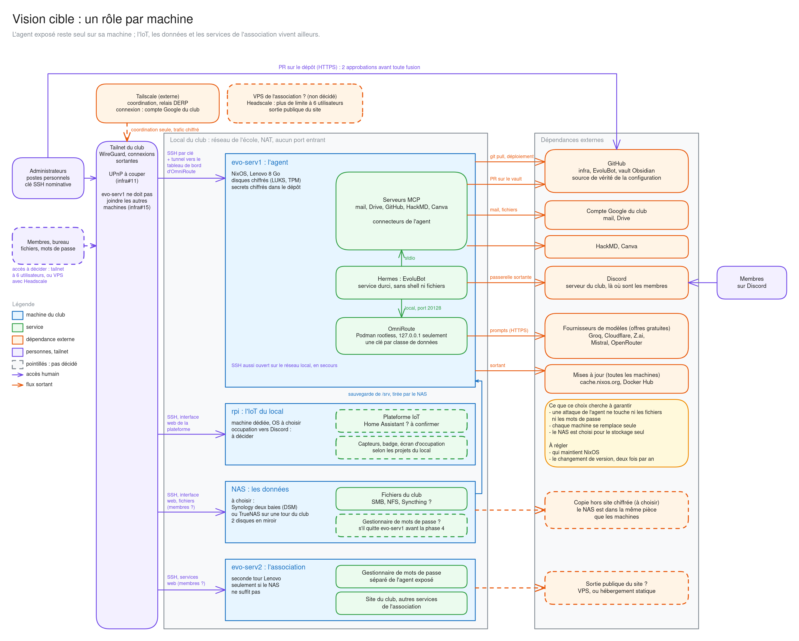
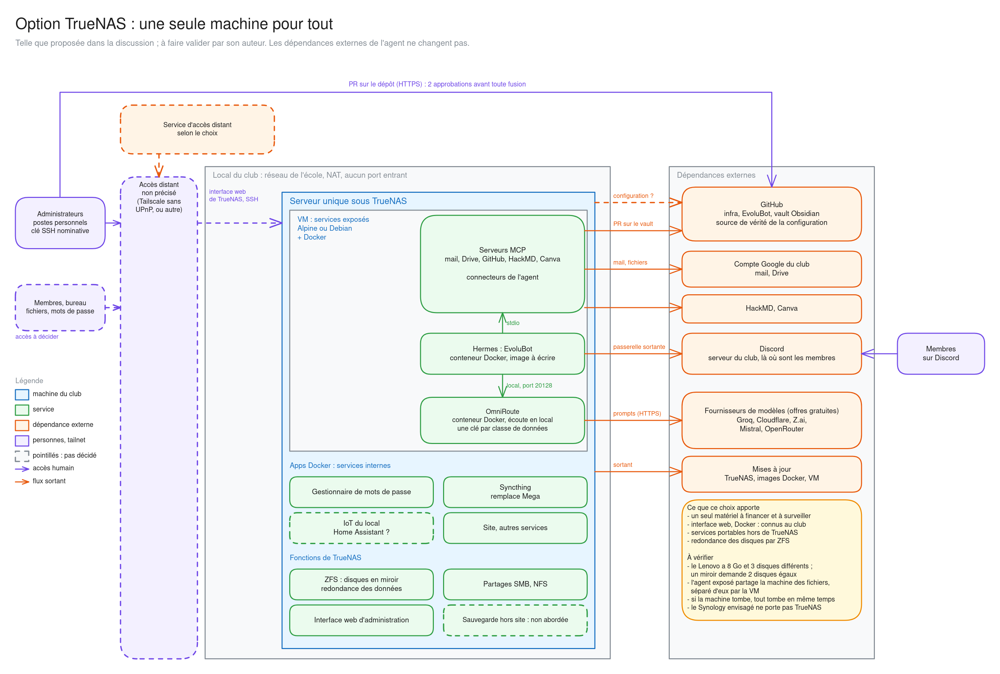
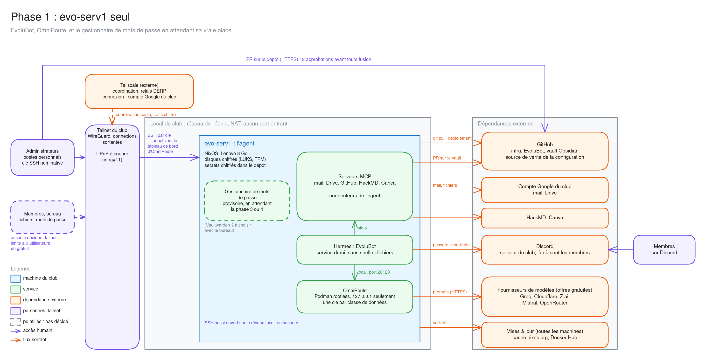
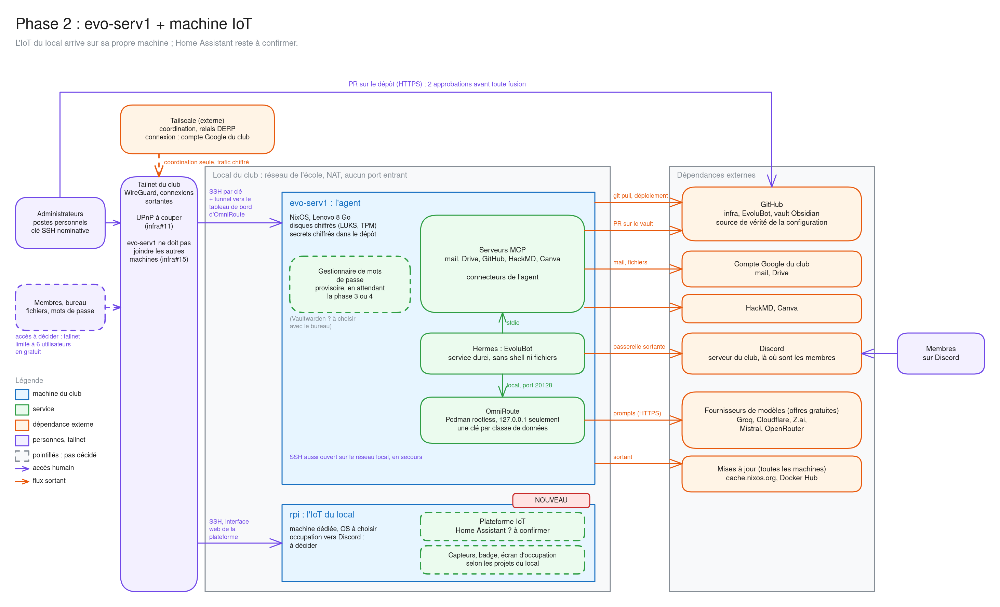
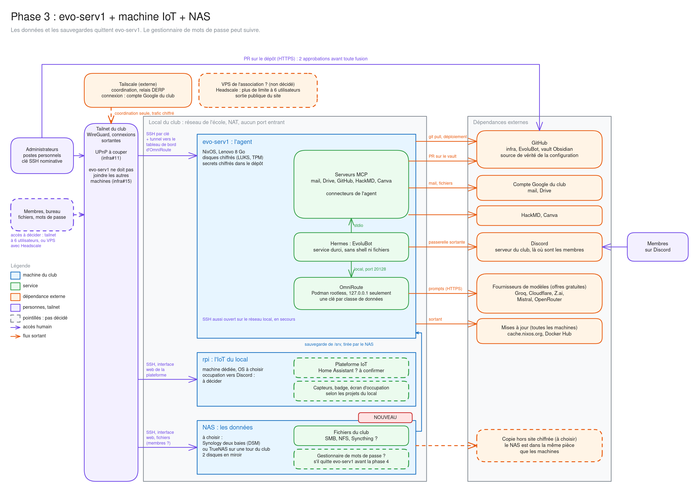
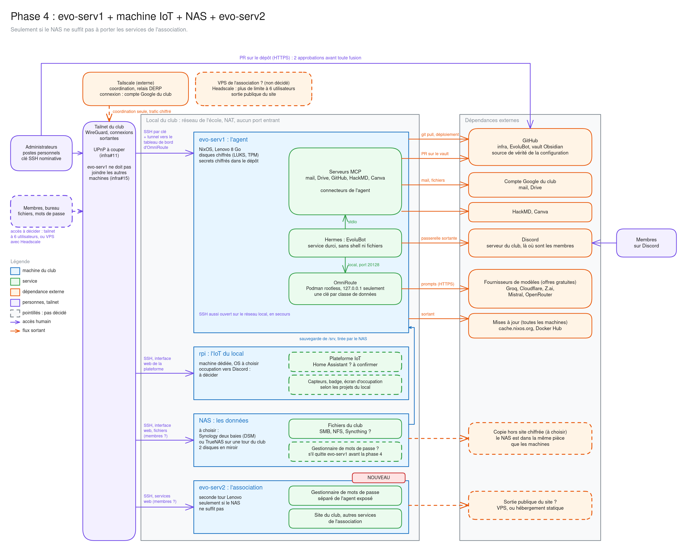

# Schémas de l'architecture

Pour discuter de la même chose : quelles machines, quels services, quelles dépendances externes, et comment on y accède. **Rien n'est décidé** : ce qui est en pointillés reste à trancher, et les phases n'ont pas d'ordre imposé.

Chaque schéma existe en image et en fichier `.excalidraw`, à ouvrir sur [excalidraw.com](https://excalidraw.com) pour le modifier.

## Deux architectures à comparer

**Un rôle par machine** : l'agent reste seul sur sa machine, l'IoT, les données et les services de l'association vivent ailleurs.

**Une seule machine sous TrueNAS** : la proposition faite dans la discussion sur la PR #1, à faire valider par son auteur.

## Les phases

**Phase 1 : `evo-serv1` seul.** EvoluBot, OmniRoute, et le gestionnaire de mots de passe en attendant sa vraie place.

**Phase 2 : une machine dédiée à l'IoT du local.** Home Assistant reste à confirmer.

**Phase 3 : le NAS.** TrueNAS ou autre, à choisir ; il reçoit les données et les sauvegardes.

**Phase 4 : `evo-serv2`.** Seulement si le NAS ne suffit pas à porter les services de l'association.

